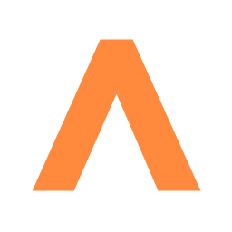
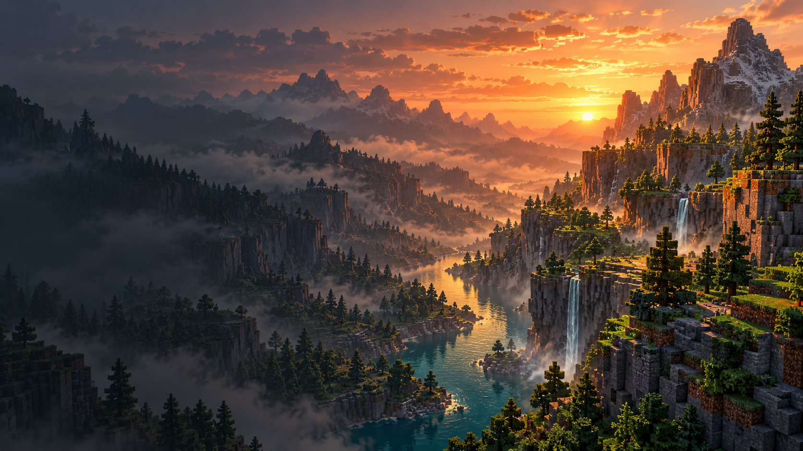

<div align="center">



# Atlas

**Minecraft на Rust. Свои возможности, графика и меню.**


Нативный клиент Minecraft: Java Edition 26.3 с собственным лаунчером.
Разрабатывается **[SFrostStar](https://github.com/SFrostStar)** на основе **[Horizon](https://github.com/horizon-rust/horizon)**.

</div>



## Содержание

- [О проекте](#о-проекте)
- [Возможности](#возможности)
- [Технологии](#технологии)
- [Запуск и разработка](#запуск-и-разработка)
- [Структура проекта](#структура-проекта)
- [Приватность](#приватность)
- [Обновления](#обновления)
- [Авторство и лицензии](#авторство-и-лицензии)

## О проекте

Atlas — независимая доработка Horizon: клиент Minecraft на Rust с собственным оформлением, новыми функциями и удобным управлением сборками. Проект поддерживается и развивается. Текущая версия — **0.1**.

## Возможности

- **Свой лаунчер.** Отдельные сборки, папки сохранений, журнал запуска и управление несколькими окнами игры.
- **Персонализация.** Русский и английский языки, светлая и тёмная темы, акцентные цвета и оформление главной.
- **Графика и меню.** Возможности движка Horizon, собственные меню Atlas и экран загрузки с логотипом и пиксельным закатом.
- **Ресурспаки.** Ускоренная подготовка ресурсов на Windows и загрузка в фоне с прогрессом.
- **Память сборки.** Настраиваемый лимит памяти нативного игрового процесса.
- **Профили.** Локальные аккаунты и подготовленный Microsoft-вход, для которого нужен собственный Client ID и доступ к Minecraft API.
- **Discord Rich Presence.** Название Atlas, логотип и текущая версия в Discord.

Совместимость и производительность зависят от компьютера, сервера и ресурсов. Это развивающийся неофициальный клиент.

## Технологии

| Часть проекта | Технологии |
| --- | --- |
| Игровой движок | Rust, wgpu |
| Лаунчер | Electron, JavaScript, HTML, CSS |
| Проверки | Node.js test runner, Playwright, Rust tests |
| Сборка под Windows | Cargo, PowerShell, LLVM-MinGW |

## Запуск и разработка

Для разработки интерфейса нужны Node.js и npm:

```sh
npm ci
npm start
```

Проверки лаунчера:

```sh
npm test
```

Подготовка игровых ресурсов и сборка Rust описаны в [руководстве движка](engine/atlas/README.md). Ресурсы Minecraft берутся из собственной законно полученной копии игры и в репозиторий не входят. Клонирование исходников само по себе не устанавливает готовую игру, локальные инструменты или подготовленные ресурсы.

Подробнее: [локальная разработка](docs/LOCAL-DEVELOPMENT.md), [изменение игры](docs/EDITING-ATLAS.md), [Microsoft-вход](docs/ACCOUNTS.md).

## Структура проекта

```text
assets/        Оформление Atlas
docs/         Инструкции
engine/atlas/  Исходники движка Rust
lib/           Логика лаунчера
scripts/       Сборка и проверки
tests/        Проверки лаунчера
```

## Приватность

В репозитории хранятся исходники и оформление проекта. `.gitignore` исключает:

- Миры, резервные копии и данные игровых сборок.
- Аккаунты, токены, файлы авторизации и локальные настройки.
- Логи, отчёты о сбоях, скриншоты и управляющие сокеты.
- Кэши, ресурсы Minecraft, скачанные инструменты и собранные приложения.

Перед отправкой проверяется список файлов:

```sh
python scripts/check_repository_privacy.py
```

## Обновления

Разработка активна. Коммиты и отправка изменений выполняются по явной команде SFrostStar после завершения выбранной функции или исправления. Релизы и теги автоматически не создаются.

## Авторство и лицензии

Автор собственных частей и изменений Atlas — **SFrostStar**: [AUTHORS.md](AUTHORS.md).

Основа движка — Horizon v0.2.93, commit `b6c936f82b08798057161bdfa577e3aac53fb91e`, с дополнительными исправлениями и доработками Atlas. Первоначальное авторство и условия MIT сохранены: [лицензия движка](engine/atlas/LICENSE), [сторонние компоненты](engine/atlas/THIRD_PARTY_NOTICES.md).

Atlas — неофициальный проект, не связанный с Mojang или Microsoft. Minecraft и его материалы принадлежат соответствующим правообладателям.
